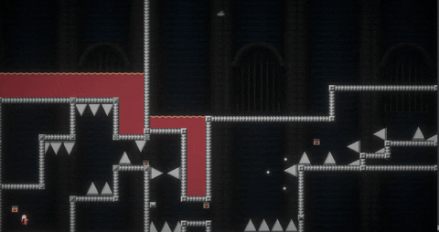
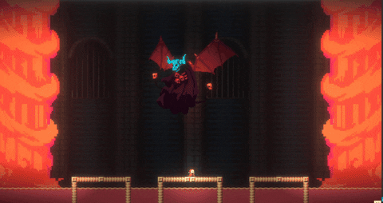

**AI를 사용하지 않고 개발한 프로젝트입니다.**

**I Wanna Be The Guy**의 팬 게임으로, 여러 게임을 테마로 한 스테이지를 담은 2D 플랫폼 게임입니다.

**Windows · 한국어 / English**

## 게임

- 점프·대시로 함정을 돌파하고 보스 공략
- Easy · Normal · Hard · Extreme 난이도
- 세이브포인트와 이어하기 지원

<table>
  <tr>
    <td width="50%"></td>
    <td width="50%"></td>
  </tr>
</table>

## 기본 조작

| 입력 | 동작 |
| :--- | :--- |
| `←` / `→` | 이동 |
| `C` | 점프 |
| `X` | 공격 |
| `Z` | 대시 |
| `R` | 재시작 |
| `P` | 이전 세이브로 되돌리기 |

키 설정에서 변경할 수 있습니다.

## 실행

- **다운로드:** [itch.io](https://myidmm64.itch.io/i-wanna-be-the-jaeby)에서 KR 또는 EN ZIP을 받아 압축 해제 후 실행
- **개발:** Unity **2021.3.38f1** → `Assets/Scenes/Splash.unity` → Play

개발: [myidmm64](https://github.com/myidmm64)
